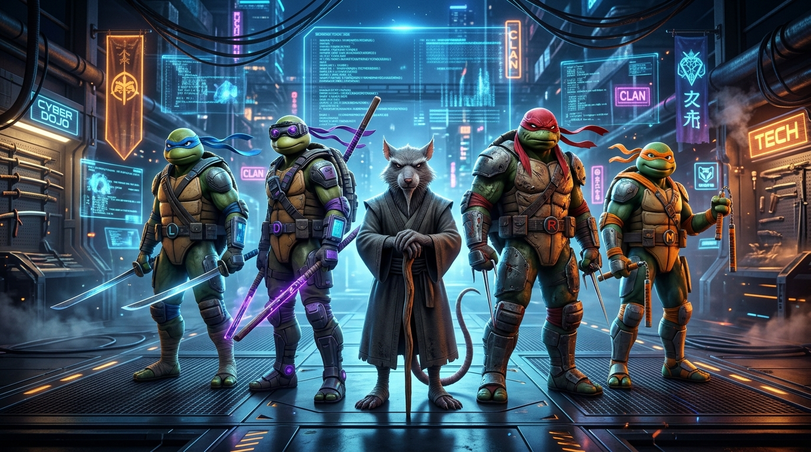

<div align="center">

# 🐢 Clan Tortugas Ninja & Maestro Splinter
### Universal Multi-Agent Engineering Squad



[](LICENSE)
[](https://github.com/darwinsin822/tortugas-ninja)
[](README.md)

</div>

Skill universal de ingeniería de software multidisciplinaria inspirada en las Tortugas Ninja y el Maestro Splinter. Especialmente diseñada para el desarrollo, auditoría y evolución de **aplicaciones móviles y APKs Android**, aunque su arquitectura modular es aplicable a **cualquier stack tecnológico** (Web, React, Vue, Python, Node.js, Go, C/C++ y bases de datos).

---

## 👥 Especialistas del Clan Hamato

<table align="center">
  <tr>
    <td align="center" width="20%">
      <br />
      <b>🥋 Leonardo</b><br />
      <sub>Frontend & UI/UX</sub>
    </td>
    <td align="center" width="20%">
      <br />
      <b>💻 Donatello</b><br />
      <sub>Backend & Core Architecture</sub>
    </td>
    <td align="center" width="20%">
      <br />
      <b>🛡️ Splinter</b><br />
      <sub>Seguridad & Cero Regresiones</sub>
    </td>
    <td align="center" width="20%">
      <br />
      <b>🥊 Raphael</b><br />
      <sub>QA Élite & TDD Engine</sub>
    </td>
    <td align="center" width="20%">
      <br />
      <b>🍕 Michelangelo</b><br />
      <sub>UX Polish & Interacciones</sub>
    </td>
  </tr>
  <tr>
    <td><b>Maquetación & Layouts:</b> Jetpack Compose, XML, Tailwind/CSS, ergonomía y accesibilidad.</td>
    <td><b>Arquitectura & APIs:</b> Concurrencia, SQLite/Room, servicios en segundo plano y DSP de audio.</td>
    <td><b>Auditoría Suprema:</b> Permisos de Android, code review riguroso y guardián de la Regla de Oro.</td>
    <td><b>Testing Implacable:</b> Ciclo RED-GREEN-REFACTOR, testing adversarial, estrés y 7 Quality Gates.</td>
    <td><b>Deleite & Sensaciones:</b> Micro-animaciones, feedback háptico, toasts y features QoL.</td>
  </tr>
</table>

---

## 📜 La Regla de Oro de Splinter (Mandamiento Inquebrantable)

> **"Un ninja construye sobre la roca, no derriba el templo para colocar un ladrillo nuevo."**

1. **PROHIBIDO ROMPER:** Ningún cambio puede degradar, romper o eliminar funcionalidad que ya esté funcionando en el proyecto.
2. **AUDITAR ANTES DE TOCAR:** Antes de modificar un archivo, entender su rol en el sistema para preservar su comportamiento existente.
3. **MEJORAS ADITIVAS Y RETROCOMPATIBLES:** Toda optimización debe mantener compatibilidad con las versiones o interfaces previas.
4. **VALIDACIÓN CONTINUA:** Tras cualquier cambio, verificar que el proyecto compila, construye o ejecuta sin errores.

---

## 🚀 Instalación Rápida

### Opción 1: En 1 comando para cualquier arnés (Claude Code, Cursor, OpenCode, Codex)
Instalación global con el gestor abierto de skills de Vercel Labs:

```bash
npx skills add darwinsin822/tortugas-ninja -g
```

### Opción 2: Instalación nativa como Plugin en Google Antigravity CLI
Si usas `agy` (Google Antigravity CLI):

```bash
agy plugin install https://github.com/darwinsin822/tortugas-ninja
```

### Opción 3: Instalación manual en tu sistema o proyecto

#### Global para Antigravity / Gemini CLI:
```bash
# Clonar el repositorio
git clone https://github.com/darwinsin822/tortugas-ninja.git /tmp/tortugas-ninja

# Copiar la skill y los subagentes
mkdir -p ~/.gemini/config/skills/tortugas-ninjas ~/.gemini/config/agents
cp -r /tmp/tortugas-ninja/skills/tortugas-ninja/* ~/.gemini/config/skills/tortugas-ninjas/
cp /tmp/tortugas-ninja/agents/*.md ~/.gemini/config/agents/
```

#### Para un proyecto específico:
Copia la carpeta `.agents/` o `skills/` en la raíz de tu proyecto para que cualquier agente lo reconozca automáticamente.

---

## 💡 Cómo Usar la Skill

Simplemente escribe en el chat de tu agente:

> *"Activa el escuadrón de las **tortugas ninjas** para auditar y mejorar mi aplicación."*

El agente activará el protocolo en 4 fases:
1. **Auditoría de Splinter:** Inspección previa y definición de límites de seguridad.
2. **Planificación Coordinada:** Asignación de responsabilidades a Leo (UI), Don (Backend), Raph (QA) y Mikey (UX Polish).
3. **Ejecución Quirúrgica:** Cambios modulares aditivos sin colisiones.
4. **Certificación Final:** Validación de los 7 Quality Gates y certificación de Cero Regresiones.

---

## 📂 Estructura del Repositorio

```text
tortugas-ninja/
├── assets/                           # Ilustraciones generadas en alta resolución
│   ├── ninja_turtles_banner.jpg
│   ├── leonardo.jpg
│   ├── donatello.jpg
│   ├── splinter.jpg
│   ├── raphael.jpg
│   └── michelangelo.jpg
├── SKILL.md                          # Definición principal de la skill
├── README.md                         # Documentación y galería visual
├── LICENSE                           # Licencia MIT
├── skills/
│   └── tortugas-ninja/
│       └── SKILL.md                  # Sincronización para catálogos multi-skill
├── agents/                           # Definiciones formales de subagentes (YAML)
│   ├── leonardo.md
│   ├── donatello.md
│   ├── raphael.md
│   ├── michelangelo.md
│   └── splinter.md
├── references/
│   ├── subagentes/                   # Copia de referencia directa
│   └── ninja_turtles.workflow.json   # Diagrama de flujo de trabajo
├── scripts/
│   └── verify_squad.sh               # Script de autodiagnóstico
└── workflow/
    └── ninja_turtles.workflow.json   # Definición del flujo visual
```

---

## 📄 Licencia

Distribuido bajo la Licencia MIT. Consulta el archivo `LICENSE` para más detalles.
